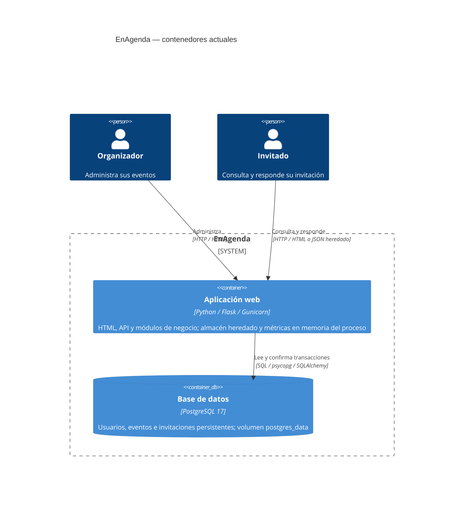

# C4 — Nivel 2: Contenedores

Los módulos Python son componentes internos de Flask, no contenedores desplegables.
La memoria heredada vive dentro de cada worker; no es una base compartida ni caché.
No se despliegan broker ni caché de negocio. PostgreSQL y Flask corresponden a los
servicios `db` y `enagenda` de `docker-compose.yml`.
